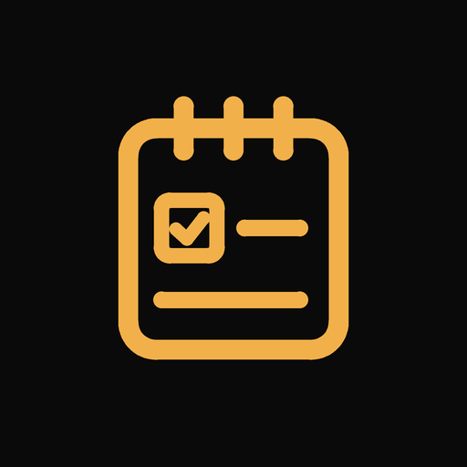
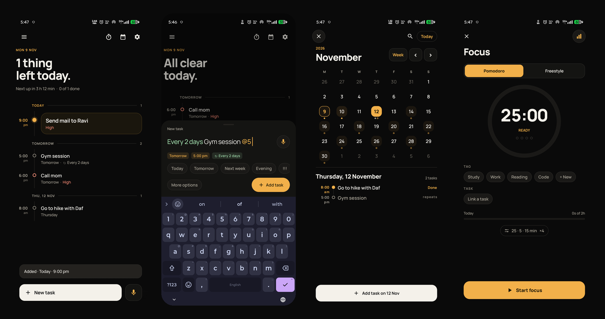

<div align="center">



# Cadence

**A quiet to-do app for Android. Type a task the way you'd say it.**

[](https://github.com/bobby-99/cadence/releases/latest)
[](#install)
[](#build)
[](#license)
[](PRIVACY.md)

<br />



</div>

<br />

Write **"Call mom tomorrow 6pm !!"** and Cadence works out the date, time and priority. It reminds you reliably, and everything stays on your phone.

## Features

| | |
|---|---|
| **Type it, don't fill it in** | "Gym every mon wed fri 7am", "Study for 45 min tomorrow 6pm". Live highlighting shows what was understood. A mic button is there too. |
| **Reminders you can trust** | Exact alarms, a catch-up for ones missed while the phone was off, and a safety net that re-arms them every 30 minutes. A priority card over any app while you use the phone, a notification when you don't. Done and Snooze work from the lock screen. |
| **One-motion swipes** | Right completes. Left opens on Edit, Snooze, Focus and Delete. Undo for a few seconds. |
| **Repeats with streaks** | Daily, weekly, monthly, custom, and "after completion". |
| **Calendar** | Week and month views, search, and your phone calendar's events alongside your tasks. |
| **Focus** | Pomodoro and freestyle timers, tags, a daily goal and an Insights heatmap. |
| **Widget and share** | Add and complete tasks from the home screen. Share text from any app into Cadence. |
| **Sync with a PC** | Phone and computer share one file in a folder you already sync (Syncthing, OneDrive, Google Drive). No server, no account. See [Sync](docs/SYNC.md). |
| **Windows app** *(early preview)* | A small native companion that reads the same list. Basic for now: list, add, complete, rename, delete. Editing, highlighting and settings are still to come. |
| **Private by design** | No account, no ads, no network access. Sync is optional and goes only through a folder you choose. Backup and restore to a file, or to a folder automatically. |

On purpose it has no projects, subtasks, task tags, accounts or collaboration, and no cloud sync. See [what belongs in Cadence](CONTRIBUTING.md#what-belongs-in-cadence).

## Install

1. Download the APK from the [latest release](https://github.com/bobby-99/cadence/releases/latest).
2. Open it. Android asks once to allow installs from your browser or file manager.
3. Follow the short first-run tutorial.

Needs Android 8.0 (API 26) or newer. Updates install over the old version and keep your tasks.

**Windows (optional, early preview):** download `Cadence-…-windows-x64.exe` from the same release page and run it. Then set up sync: on the phone, Settings, Backup and restore, *Sync with a computer*; on the PC, the *Sync* button. Pick the same folder on both (a Syncthing, OneDrive or Google Drive folder). More in [windows/README.md](windows/README.md).

## Build

JDK 17 and the Android SDK 35, or just open the folder in Android Studio.

```sh
gradle :app:testDebugUnitTest    # tests
gradle :app:assembleRelease      # the APK
```

Without the maintainer's key the build is signed with your debug key, so it installs but won't update the official release. Maintainers: see [docs/RELEASING.md](docs/RELEASING.md).

<details>
<summary>Project layout</summary>

```
app/src/main/java/com/bobby/cadence/
  data/    database, repository, preferences, backup, phone-calendar bridge
  nlp/     the task parser (plain Kotlin, unit tested)
  alarm/   scheduler, notifications, priority card, focus timer
  ui/      Compose screens: home, editor, calendar, focus, settings, tutorial
  widget/  home-screen widget
windows/   Cadence for Windows (Rust + Slint): core/ is shared logic with tests, app/ is the window
docs/SYNC.md   the sync file format both apps follow
```

</details>

## Contributing

Focused bug reports and pull requests are welcome. Read [CONTRIBUTING](CONTRIBUTING.md) first; it's short. Security issues go to [SECURITY](SECURITY.md).

## License

[PolyForm Noncommercial 1.0.0](LICENSE): free for personal, hobby and study use; not for sale or any commercial use. It is source-available, not OSI open source. Third-party components are in [NOTICE](NOTICE). Privacy details: [PRIVACY](PRIVACY.md).
